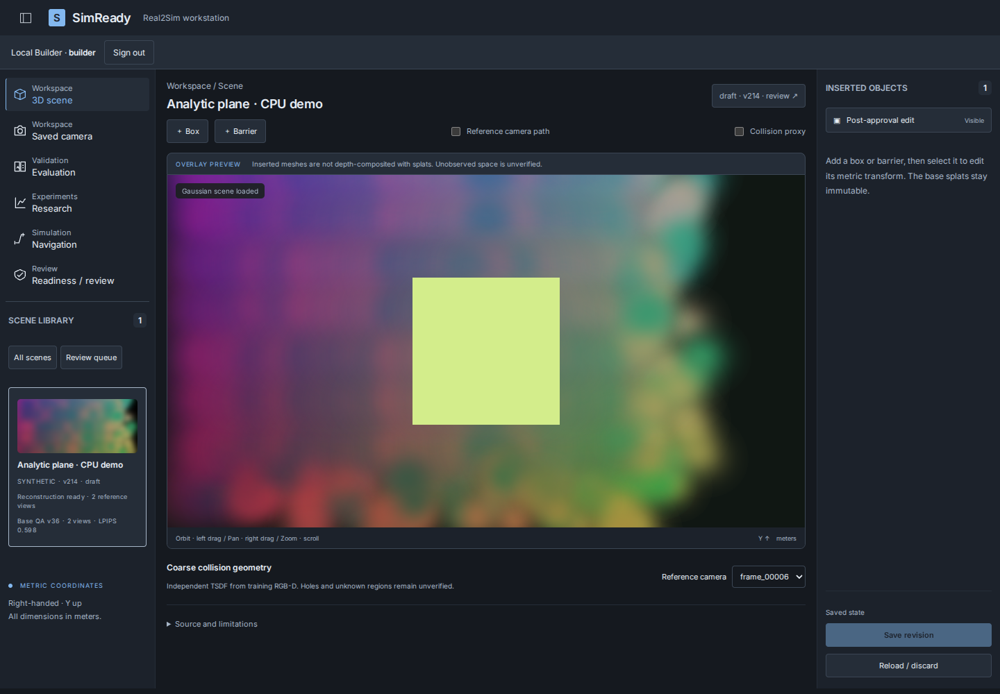
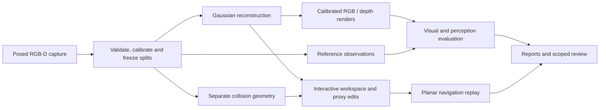

# SimReady

SimReady reconstructs posed RGB-D captures as editable 3D Gaussian scenes and
compares rendered views with real observations. It connects visual reconstruction,
perception evaluation and lightweight navigation checks: a convincing render can
still contain errors that matter to perception or simulation.

## Demo



Current interface running the genuinely trained **synthetic analytic demo**.
This screenshot is application evidence, not a real-scene reconstruction benchmark.

[Watch the recorded application walkthrough](docs/media/tum-walkthrough.webm)
— a genuine TUM reconstruction, proxy editing, frozen-view validation, navigation
replay and scoped review. [Recording details and limitations](docs/WALKTHROUGH.md).
The recording predates the workstation-shell redesign. Individual workflow-panel
refinements and research extensions remain in progress.

## Capabilities

- **Reconstruction:** RGB-D ingestion with supplied poses, gsplat training,
  portable Gaussian artifacts, RGB/depth rendering and reloadable checkpoints.
- **Scene workspace:** interactive Gaussian viewing, calibrated saved cameras,
  persistent rigid proxy insertion and transform editing.
- **Validation:** aligned PSNR, SSIM, LPIPS, supported-depth errors, detector
  agreement, per-view failure maps and JSON/CSV/HTML reports.
- **Navigation prototype:** separate collision geometry, planar route planning,
  obstacle layouts and deterministic replay. This is not a physics simulator.
- **Reproducibility:** frozen splits, source/configuration hashes, seeded runs,
  training logs, quality/runtime comparisons and scoped review/export records.

Real annotated detection accuracy, independent-scene confirmation and extended
refinement experiments are current work, not established capabilities or results.
See the [improvement plan](docs/IMPROVEMENT_PLAN.md).

## Architecture



Gaussian appearance and collision geometry have separate representations. The
isolated GPU worker performs training/inference; the API and browser remain
separate from those processes. [Architecture](docs/ARCHITECTURE.md).

## Measured results

The reconstruction-quality study used TUM `freiburg1_desk`, 50 training and
16 validation frames, three seeds, fixed 320×240 evaluation and a GTX 1660 Ti.
Selection used validation only; these are **not independent-test results**.

| Configuration | Updates | Validation LPIPS ↓ | PSNR dB ↑ | Optimization seconds |
|---|---:|---:|---:|---:|
| Original L1 baseline | 1,200 | 0.32864 ± 0.00107 | 15.072 ± 0.018 | 9.25 ± 0.13 |
| Matched-budget L1 control | 3,600 | 0.28287 ± 0.00061 | 15.353 ± 0.070 | 25.25 ± 0.52 |
| L1 + SSIM | 3,600 | 0.24201 ± 0.00219 | 15.444 ± 0.051 | 30.96 ± 0.95 |

Values are mean ± sample SD. L1+SSIM also produced more Gaussians and slightly
higher supported-depth MAE than the matched control. Holes and blur remain.
Cap20k, SH0 and depth-off worsened matched-budget mean LPIPS in this study.
[Full protocol, all variants, failure cases and provisional audit](docs/RECONSTRUCTION_QUALITY_RESULTS.md).

The separate recapture study reported a negative result: risk-based acquisition
was worse than random on LPIPS by **0.01473 ± 0.00426** across three seeds on the
same 18 newly held-out views. That final-evaluation experiment has a different
protocol from the validation-only quality study above; the two are not pooled.
[Recapture results and limitations](docs/M5_RESULTS.md).

## Quick start

Requires Python 3.12, uv and a supported Node.js version; see
[installation](docs/ENVIRONMENT.md) for pinned compatibility.

```bash
make setup
make demo
make studio
```

Open the address printed by the server. The lightweight demo uses an actual
pretrained analytic scene and saved evaluations. Viewing and proxy editing need
no CUDA training environment. Local account setup is described in
[accounts and review](docs/REVIEW_PROTOCOL.md).

For real RGB-D import, training and new evaluation, follow the separate
[GPU setup guide](docs/GPU_SETUP.md) and [CLI reference](docs/CLI.md).
GPU support was measured on the documented environment; arbitrary captures and
training configurations may require different resources.

## Documentation

- [Dataset provenance, coordinates and splits](docs/DATASET_PROTOCOL.md)
- [Evaluation methodology](docs/EVALUATION_PROTOCOL.md)
- [Reconstruction-quality reproduction](docs/RECONSTRUCTION_QUALITY_PROTOCOL.md)
- [Scene editing and artifacts](docs/SCENE_PROTOCOL.md)
- [Navigation scope and results](docs/SIMULATION_PROTOCOL.md)
- [Measured pipeline benchmarks](docs/BENCHMARK_RESULTS.md)
- [Contributing workflow and developer records](AGENTS.md)

## Limitations and future work

Current evidence is limited by capture coverage, pose/depth uncertainty and
correlated views. Depth errors depend on reported prediction support. Detector
agreement is not annotated detection accuracy. Edited proxies are separate from
reconstruction appearance; navigation checks do not establish real-robot safety,
physical realism or sim-to-real transfer. External simulator integration remains
unvalidated.

Independent-scene evaluation, controlled densification and annotated perception
benchmarks are planned in the [current work plan](docs/IMPROVEMENT_PLAN.md).

Source: [MIT](LICENSE). Dependencies and data have separate
[licenses and attribution](THIRD_PARTY.md). TUM-derived demo media credits Sturm
et al., IROS 2012, under CC BY 4.0. Dataset downloads and learned scene assets are
kept outside Git.
