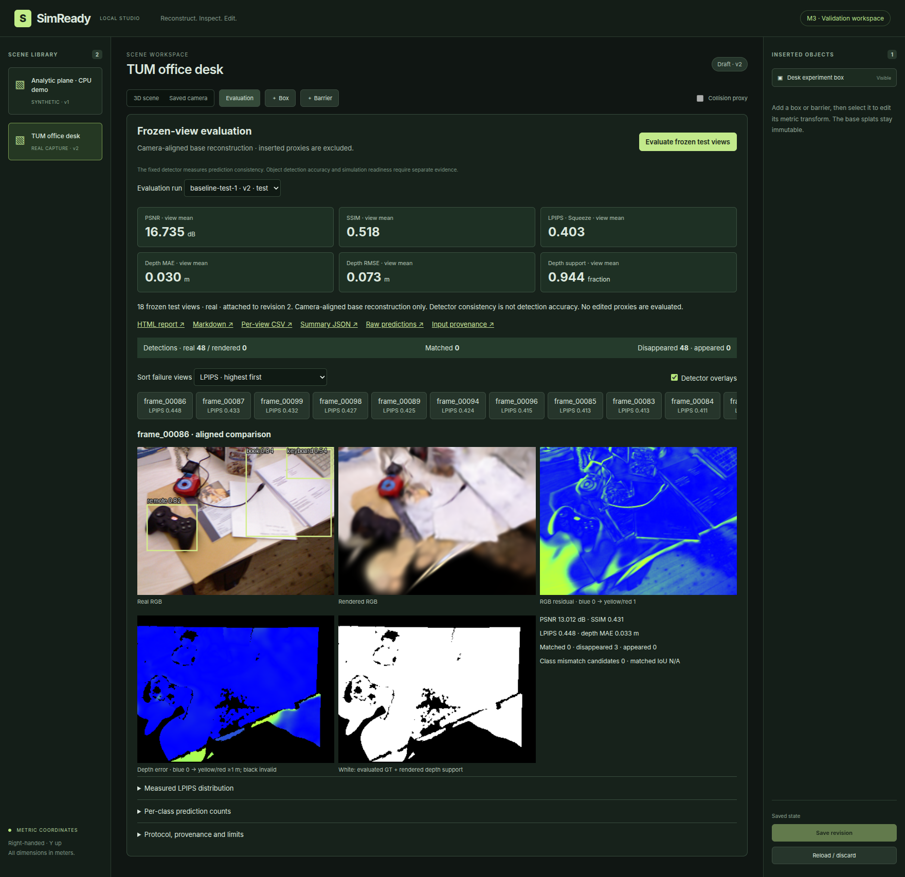

# SimReady

`PLAN.md` is the specification. **M0–M5 are complete locally, with qualified research evidence.** The user has
authorized completing the full project.
The studio supports persistent rigid proxy editing and frozen-view perception
evaluation, deterministic navigation and scoped local review/export.
M5's real recapture case study, labeled analytic companion, integrity audits and
research dashboard are documented. Risk-based recapture did not outperform random
on this case study; see [results](docs/M5_RESULTS.md). M6 shipping checks remain
open in the [shipping checklist](docs/M6_CHECKLIST.md). Authenticated queued
[import, reconstruction and supplied-camera render APIs](docs/PIPELINE_API.md)
have local subprocess/CUDA acceptance evidence.

M0 provides a CPU-only RGB-D import/validation package, explicit camera
conventions, an analytic fixture with known metric geometry, frozen dataset
splits, and a React/TypeScript shell. M1 adds an isolated gsplat training/render
adapter and a genuinely trained analytic demo for CPU smoke checks. See
[progress](docs/PROGRESS.md) and the
[acceptance checklist](docs/M0_CHECKLIST.md) for actual verification evidence.

## Recorded walkthrough

[Watch the50.8-second real-scene walkthrough](docs/media/tum-walkthrough.webm):
saved TUM reconstruction →metric box edit →frozen QA →simulated route replay
→scoped automated local review/export. [Script, chapters and verification](docs/WALKTHROUGH.md).
The clip uses a genuine saved model/report; it does not imply live training or
human endorsement. TUM reference/derived imagery: Sturm et al., IROS2012,
[CC BY4.0](https://creativecommons.org/licenses/by/4.0/).
[Measured CV evidence](docs/CV_EVIDENCE.md) lists supported claims and exclusions.

## Setup

Run from the repository root. Python 3.12, uv and npm are required. Node 20.20.2
is tested (Vite also supports compatible Node 22.12+). No GPU is required. The [fresh CPU demo acceptance](docs/FRESH_INSTALL.md)
records an independently installed checkout, browser tests and missing-GPU fallback.

```bash
make setup
make test
make demo
make storage
```

`make setup` installs exact locked dependencies. `make test` runs CPU pytest,
Ruff lint/format checks, the frontend scope test and production build. It uses
the official sample if present; otherwise that one test skips explicitly.
`make demo` generates/validates the eight-frame analytic input fixture and loads
a small bundled, genuinely trained Gaussian checkpoint plus two saved views.
The CPU smoke validates saved artifacts; it does not perform live rendering.

## Small official RGB-D integration sample

**Correction:** Open3D's Redwood sample is synthetic Redwood/ICL-NUIM, not a real
Kinect capture. The original M0 classification was wrong and is superseded.
New imports label it synthetic, and old mislabeled records are rejected.

```bash
make fetch-example      # optional network access; official ZIP is about 3.8 MB
make import-example     # import five synthetic RGB-D pairs and supplied poses
make test-official      # require the official sample and run its integration test
```

Equivalent CLI commands (new output directories required for creation):

```bash
uv run --frozen simready data synthetic --out data/scenes/my_fixture
uv run --frozen simready data fetch --out data/raw/redwood
uv run --frozen simready data import --source data/raw/redwood --format open3d_redwood_sample --out data/scenes/redwood-synthetic-v2
uv run --frozen simready data validate --scene data/scenes/redwood-synthetic-v2
uv run --frozen simready data split --scene data/scenes/redwood-synthetic-v2
```

Imports generate `manifest.json`, `frames.jsonl`, `splits.json`, RGB and depth
files, and source calibration/provenance. Metadata is versioned and read-only;
validation detects content/hash changes, split overlap, bad images, calibration,
poses and timestamps. `data split` **verifies the frozen split**, without creating
a new partition. A new dataset version requires a new output directory.

The official synthetic sample has 2 train / 1 validation / 1 candidate / 1 test frame. Its
adjacent views, supplied estimated odometry, nominal world-up and frame-index
timestamps make this an import check, not credible held-out scientific evaluation.
See [dataset protocol](docs/DATASET_PROTOCOL.md) for conventions and limitations.

## Real capture and GPU reconstruction

The real-data path uses TUM's Kinect `freiburg1_desk` sequence, with original
timestamps and interpolated motion-capture optical-center poses.

```bash
uv run --frozen python scripts/fetch_tum_data.py
uv run --frozen simready data import --source data/raw/rgbd_dataset_freiburg1_desk.tgz --format tum_rgbd --max-frames 100 --out data/scenes/tum-fr1-desk
make test-real
make gpu-setup
uv run --frozen simready recon train --scene data/scenes/tum-fr1-desk --preset local_6gb --out artifacts/scenes/tum-fr1-desk/baseline
uv run --frozen simready recon render --artifact artifacts/scenes/tum-fr1-desk/baseline --scene data/scenes/tum-fr1-desk --split test --out artifacts/renders/tum-fr1-desk-test
make test-gpu
```

GPU setup is optional for CPU smoke and isolated from the core environment.
See [GPU setup](docs/GPU_SETUP.md) for its exact supported runtime. Training
initializes only from training RGB-D; exported `gaussians.npz` and Graphdeco SH
`gaussian.ply` stay in metric coordinates. Saved provenance records source/split
hashes, seed, configuration, source revision, GPU/package versions, elapsed time,
and PyTorch allocator memory peaks. Expected rendered depth is axial Z in meters,
and must be masked by the saved alpha/support image before downstream comparison.

## Frozen-view perception validation

Use the **Evaluation** tab to inspect a registered report or queue evaluation of
all frozen test views. The CPU demo includes an actual measured two-view analytic
report; it requires no GPU to inspect. Evaluation itself uses the isolated GPU
worker. Reports include paired RGB, residual/depth support maps, raw detector
predictions, per-view CSV, summary JSON, Markdown/HTML, and content/input hashes.
See the [pinned protocol](docs/EVALUATION_PROTOCOL.md) for commands and definitions.

Actual TUM fr1 desk baseline: 18 frozen test views, mean **16.735 dB PSNR**,
**0.518 SSIM**, **0.403 LPIPS Squeeze**, **0.0301 m depth MAE** on supported GT
pixels (mean completeness **0.944**). At fixed confidence >=0.5, the detector has
**48 predictions on real images and zero on rendered images**. These are summed
per-view predictions, not distinct objects or detection-accuracy measurements.
This is a documented failure case, not a readiness or safety claim.

[Actual measurements and nine inspected failures](docs/M3_FAILURE_CASES.md)
trace to clean source `06114ba` and frozen input hashes. No threshold or pose
adjustment was made to improve the test result.



## Navigation and scoped review

The Navigation tab saves metric scenarios, blocks unknown floor cells and runs
A* plus swept replay. Actual TUM coarse-map regression:1.05m baseline,1.15m detour
around an inserted box, and no route after a barrier. These results concern our
simplified known map, not real robot performance.

The account bar uses separate local Builder/Reviewer tokens. `--demo` provisions
`artifacts/studio/local-credentials.json` privately; read it locally and paste the
appropriate token. Builders edit/run/submit; a distinct Reviewer records a named,
limited decision. Editing creates a new draft while preserving old approval.
Reviewed ZIPs separate splats/colliders and carry scope, QA, audit and content
hashes. The real TUM acceptance uses an explicitly **automated local-role fixture**,
not human endorsement. Its perception failures and unknowns remain visible.

[Navigation protocol/results](docs/SIMULATION_PROTOCOL.md) ·
[Accounts, readiness, review and export](docs/REVIEW_PROTOCOL.md) ·
[M4 acceptance](docs/M4_CHECKLIST.md)

## Measured recapture case study

The **Research** tab includes an actual measured TUM summary, viewable without a
GPU. It labels the precomputed snapshot and its omitted raw files explicitly.
The full study used three seeds, four methods and the same18new held-out views.
Risk recapture did worse than random on LPIPS for all three seeds:
**risk-minus-random +0.01473 ± 0.00426** (sample SD; lower is better).
This is one correlated capture, not a general method or detection-accuracy claim.

[Results, figures and failures](docs/M5_RESULTS.md) ·
[Reproduction and registration](docs/RECAPTURE_PROTOCOL.md) ·
[Fresh provisional integrity audit](docs/EXPERIMENT_AUDIT.md)

## Local scene workspace

```bash
make studio
```

Open [the local scene workspace](http://127.0.0.1:8000). The bundled analytic
demo needs no CUDA or optional geometry install. Orbit the actual learned splats,
add a box/barrier, select it, edit position/rotation/size, toggle visibility and
collider, then save. Reloading preserves the saved version. Stale saves return
a conflict while keeping local edits. Saved-camera mode supports numeric editing
when WebGL2 is unavailable. Base splats remain immutable.

The editor explicitly labels mesh insertion as an **overlay preview**. It does
not claim verified occlusion or edited-scene perception realism. Coarse TSDF
geometry is independently toggleable; unknown regions remain unverified.

For frontend development, start `uv run --frozen simready api serve --demo` and
run `make frontend` in another terminal; Vite proxies `/api` to loopback port 8000.

Register the actual real reconstruction after M1 commands:

```bash
make setup-geometry
OMP_NUM_THREADS=4 uv run --frozen --extra geometry simready geometry build --scene data/scenes/tum-fr1-desk --out artifacts/geometry/tum-fr1-desk/tsdf
uv run --frozen simready scene create --id tum-fr1-desk --name "TUM office desk" --dataset data/scenes/tum-fr1-desk --artifact artifacts/scenes/tum-fr1-desk/baseline --geometry artifacts/geometry/tum-fr1-desk/tsdf --renders artifacts/renders/tum-fr1-desk-test
```

Scene IDs/output paths must be new for registration. See [scene protocol](docs/SCENE_PROTOCOL.md)
for revision semantics, collision scope and controlled asset serving.

```bash
make browser-setup
make test-browser
```

Browser tests execute the live API and actual WebGL2 renderer, verify nonempty
rendered pixels and orbit movement, and exercise edits, reload, deletion,
visibility, conflicts and saved-camera fallback. Hosted CI is configured but
has not run because no remote is configured.

## Storage and provenance

The environment is locked in `uv.lock` and `frontend/package-lock.json`.
`make` keeps subsequent uv/npm caches inside the project. Raw data, local
dependencies, caches and builds are ignored by Git. The full working project
has a **30,000,000,000-byte** budget. `make storage` accounts conservatively for
logical/allocated file sizes, hidden files and directories; acquisition performs
budget preflight checks. The small Open3D sample is capped at 20 MB download /
25 MB extraction; TUM acquisition has a separate 500 MB download cap and bounded
selected-frame import. No large datasets or model checkpoints are committed.
This is a guard, not an OS disk quota; check before and after external installs.

The official sample is fetched from the [Open3D release](https://github.com/isl-org/open3d_downloads/releases/tag/20220301-data)
and verified by pinned SHA-256. Dataset redistribution terms remain unverified;
data is kept local and excluded from Git. The generated analytic fixture is CC0.
The project code's distribution license has not been selected.

Git author and committer dates for the initial M0 commits are intentionally
assigned across June–October 2026 at the user's request. Development and
verification actually occurred on October 29, 2026; dates are not evidence of
months of work. See [decisions](docs/DECISIONS.md), [environment](docs/ENVIRONMENT.md)
and [limitations](docs/LIMITATIONS.md). Local CI-equivalent commands are verified;
hosted GitHub Actions has not run because no remote is configured.

M1 has genuinely reconstructed the real TUM sequence and reloaded/rendered all
18 frozen test cameras. See [M1 acceptance](docs/M1_CHECKLIST.md) for evidence.
Image/perception quality has not been measured. M3 perception validation is next;
later milestone completion remains conditional on its own tests.


Local shipping performance is measured in [benchmark results](docs/BENCHMARK_RESULTS.md):
320×240 warm GPU rasterization656.77FPS (excludes IO/startup/browser), fresh
18-pair evaluation12.77s, sequential loopback read API p95≤3.82ms. Raw samples,
hardware, exclusions and a reproducible command accompany these observations.
