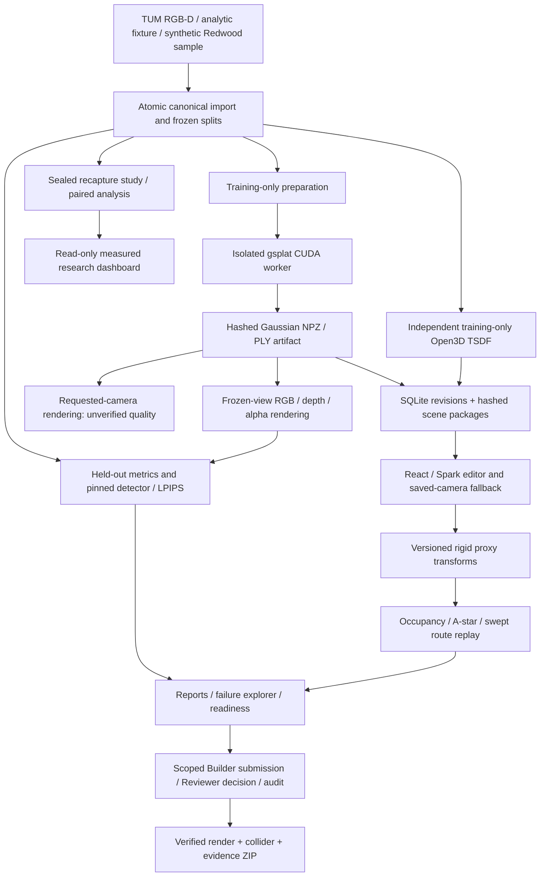

# Implemented architecture

Pydantic validates versioned contracts. World coordinates are metric, right-handed
Y-up; poses explicitly map OpenCV cameras into that world. SHA-256 binds source
records, immutable splits, model content and reports. Atomic staging protects
outputs. Storage accounting runs without third-party packages and includes local
environments, caches, Git and generated assets. Acquisition uses bounded preflight
checks; deployment-specific resource policy remains in developer configuration.

The CPU package does not import torch. A separate Python3.10 `.venv-gpu` runs
pinned gsplat/torch kernels through JSON requests and safe NPZ tensors. Saved
learned analytic assets support CPU-only smoke without claiming live CPU Gaussian
rendering. Open3D geometry is an optional CPU extra. The browser uses Spark;
inserted meshes are explicitly overlay-only, separate from scientific renders.

FastAPI serves loopback by default. Opaque local tokens identify Builder/Reviewer
roles. SQLite holds immutable scene revisions, persistent import/reconstruction/
render/evaluation jobs, review state and audit records. Worker subprocesses write
bounded pollable logs; reconstruction, render and evaluation share a GPU lock.
Controlled download routes validate hashes and allowlisted assets. Imports and
new learned models require explicit geometry/scene registration before editing;
HTTP preprocessing does not claim automatic complete scene assembly.

Frozen-view evaluation preserves raw predictions and per-view methodology.
Requested-camera outputs are labeled `custom_unverified` and cannot enter the
held-out evaluation path. Navigation uses an independently declared occupancy
model and reproducible replay; results are simulated, not real robot evidence.
Review approval is limited to a specified use case/version/region and is not a
safety certificate. The local OS owner controls both role credentials.

Research separates candidate release from sealed selection and test access.
The real TUM recapture result is negative; the labeled analytic bench companion
is a separate narrow accuracy case. Reports retain their original hashes;
bundled dashboard snapshots explicitly omit large raw model/prediction files.
See [M5 results](M5_RESULTS.md), [limitations](LIMITATIONS.md),
[GPU setup](GPU_SETUP.md) and [pipeline API](PIPELINE_API.md).
