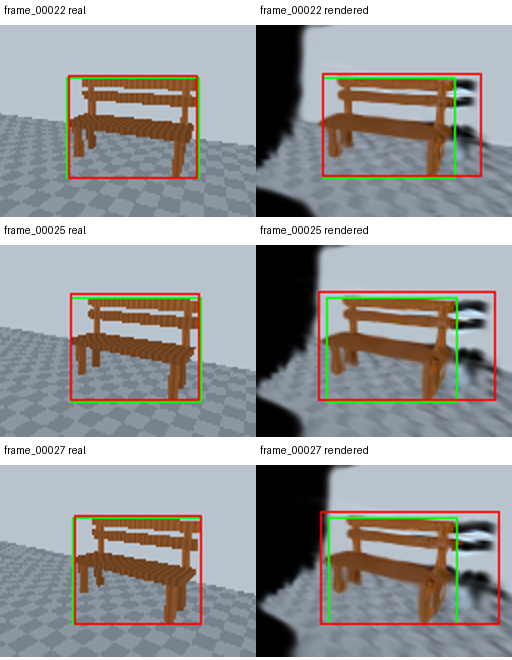

# Labeled synthetic companion

One authored synthetic bench; six correlated views. No real-domain inference.

Custom bench-class 101-point AP50; not official COCO mAP.

Green: geometry truth. Red: bench predictions at confidence ≥0.5.

```json
{
  "schema_version": "1.0",
  "scope": "One authored synthetic bench; six correlated views. No real-domain inference.",
  "metric": "Custom bench-class 101-point AP50; not official COCO mAP.",
  "confidence_threshold": 0.5,
  "iou_threshold": 0.5,
  "label": 15,
  "truth_origin": "Authored geometry ray intersections; no model outputs",
  "test_ids": [
    "frame_00022",
    "frame_00023",
    "frame_00024",
    "frame_00025",
    "frame_00026",
    "frame_00027"
  ],
  "domains": {
    "real": {
      "tp": 6,
      "fp": 0,
      "fn": 0,
      "precision": 1.0,
      "recall": 1.0,
      "ap50": 1.0
    },
    "rendered": {
      "tp": 6,
      "fp": 0,
      "fn": 0,
      "precision": 1.0,
      "recall": 1.0,
      "ap50": 1.0
    }
  },
  "correlations": {
    "lpips_vs_true_error_change": {
      "rho": null,
      "reason": "constant input; rank correlation undefined"
    },
    "prediction_disagreement_vs_true_error_change": {
      "rho": null,
      "reason": "constant input; rank correlation undefined"
    }
  },
  "frozen_inputs": {
    "annotations_sha256": "51703163b7935935e227a00314f52539170c8fdd9d11272129da086a11206275",
    "geometry_sha256": "77b0ce39276b623c1b6cab612f31bc191138f3ff06fa61ede34aa8523a853718",
    "manifest_sha256": "e20ac1b79b98294a586b9857584e5f29430065d947cedfc17cf48f2aa3149a2c",
    "plan_sha256": "b9a9ee839d4d3e06e65a4bcbbe1db46fd05d80ea59ac20a16985c34ec90b72d3"
  },
  "analysis_source": {
    "commit": "81a8985d860953cecd9fcbd90f579bc7d8a9febe",
    "dirty": false
  },
  "shared_missed_views": 0
}
```

Six views contain six observations of one object, not six independent objects. Other categories remain in raw predictions, outside this class-only metric. Null correlations are undefined. Shared misses, when observed, undermine agreement. TUM is unchanged. No human annotation, real-domain accuracy or significance claim.


Historical generic RGB/depth report boilerplate says no object annotations. That sentence is inaccurate for this companion: the base report did not evaluate labels, while this separate analysis uses geometry-derived truth. The source wording is corrected for future reports; frozen outputs remain unchanged.



See BENCH_COMPANION_AUDIT.md for the fresh provisional review.
