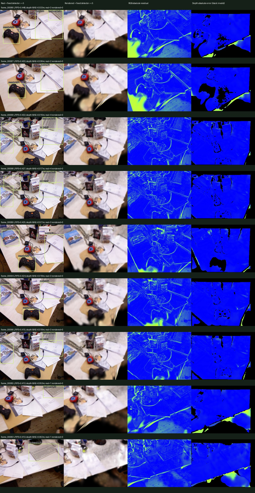

# M3 qualitative failure inspection

Actual run: `artifacts/evaluations/tum-fr1-desk-test-1`, created from clean source `06114ba12015488788cbd411b10c9963176913d7` on 2026-10-29. No retraining, threshold adjustment or test-view pose/exposure correction followed this inspection.

We inspected the **nine highest-LPIPS views**, selected mechanically from all 18 frozen test views. They include adjacent, highly correlated cameras and do not represent nine independent failure modes. The paired images, residual and depth-support maps were visually inspected; the table below is descriptive, not manually annotated object truth.

Columns: real RGB + detector, rendered RGB + detector, mean absolute RGB residual, absolute depth discrepancy. Blue is zero error; yellow/red is larger (RGB scale 1, depth scale 1 m); black depth pixels are invalid/excluded support. Source RGB: TUM RGB-D, Sturm et al., IROS 2012, CC BY 4.0. Renders/overlays/residuals and the contact sheet are derived visualizations.

| Frame | LPIPS Squeeze | PSNR dB | Depth MAE m | Real / render detections | Observation |
|---|---:|---:|---:|---:|---|
| frame_00086 | 0.4478 | 13.012 | 0.03350 | 3 / 0 | Paper text and cable edges blur; the controller-shaped foreground item loses its silhouette. Strong residual follows the desk boundary. Three real-image predictions have no rendered counterpart. |
| frame_00087 | 0.4326 | 12.245 | 0.03624 | 2 / 0 | Neighboring view shows the same blurred foreground and papers, with a broad dark smear below the tabletop. Two real-image predictions disappear. This is correlated with frame 86, not independent evidence. |
| frame_00099 | 0.4320 | 18.370 | 0.01640 | 4 / 0 | Upright packages, books and the keyboard are visible in RGB but their print/key detail is washed out in the render. Four real predictions disappear despite a supported-depth MAE below 2 cm. |
| frame_00098 | 0.4267 | 18.265 | 0.01705 | 4 / 0 | Another late view retains the table arrangement but loses fine edges/text in books and keyboard. Four real predictions disappear; low depth MAE does not imply detector consistency. |
| frame_00089 | 0.4253 | 16.416 | 0.02093 | 3 / 0 | Book/paper boundaries and the dark foreground item are visibly softened. Three real predictions disappear; the largest residuals trace structured object edges rather than a uniform exposure offset. |
| frame_00094 | 0.4243 | 16.097 | 0.01834 | 3 / 0 | The lower controller-shaped item becomes a blurred dark blob and paper print fades. Three real predictions disappear. Black depth-error regions are excluded/unknown support, not zero depth error. |
| frame_00096 | 0.4149 | 17.695 | 0.01843 | 3 / 0 | The upper-right keyboard and small upright packages lose high-frequency detail; four sides of paper sheets remain visible but less sharp. Three real predictions disappear. |
| frame_00085 | 0.4133 | 15.841 | 0.05332 | 1 / 0 | Desk-edge/floor boundary smearing accompanies 5.33 cm supported-depth MAE, higher than most selected views. The one real keyboard prediction disappears. |
| frame_00083 | 0.4128 | 17.174 | 0.06152 | 1 / 0 | Close view of the keyboard and papers is strongly blurred; the table/floor boundary also has elevated depth discrepancy (6.15 cm MAE). The real keyboard prediction has no rendered counterpart. |

Across all 18 views, the fixed >=0.5 comparison threshold yields **48 real-image predictions and zero rendered-image predictions**: 28 `book`, 11 `keyboard`, 9 `remote` predictions summed across views. These are **not 48 distinct physical objects**. Real predictions themselves are not GT; for example, the detector labels a controller-shaped item as `remote`. Lower-confidence backend outputs remain in the saved raw predictions. We did not lower the threshold to improve reported agreement.

The imagery is consistent with substantial blur/detail loss in this short local reconstruction, but this single case study cannot attribute detector failures causally to blur, quantify downstream task accuracy, certify geometry or readiness, or establish generalization. The metrics intentionally expose this unsuccessful perception result.

Provenance and actual values: [summary](evidence/m3-tum-summary.json), [per-view CSV](evidence/m3-tum-per_view.csv), [content-hashed run manifest](evidence/m3-tum-evaluation.json). Full paired images, raw predictions, HTML/Markdown and input hashes remain in the local evaluation directory and registered studio report `baseline-test-1`.

