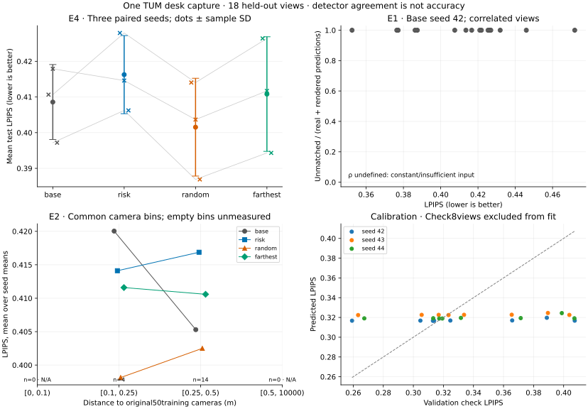
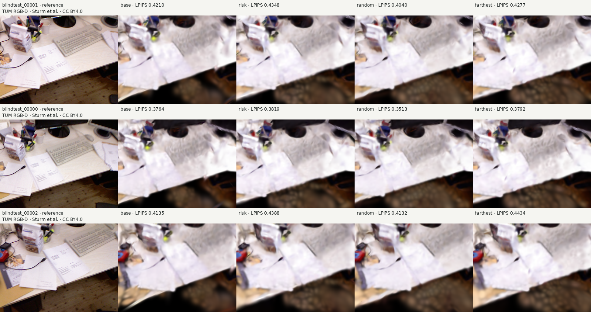
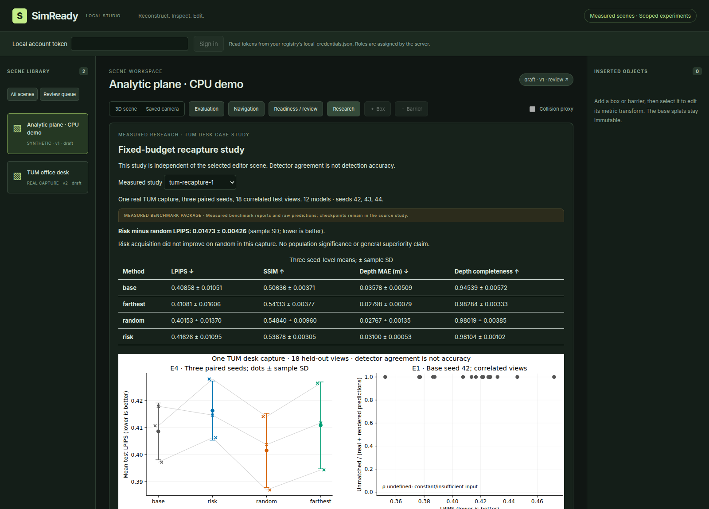

# M5 — Frozen-budget TUM recapture case study

One real TUM capture, three paired seeds, 18 correlated test views.

Descriptive engineering case study; no novelty, population significance, safety or transfer claim.

## Raw run table

|Run|Train|LPIPS|PSNR dB|SSIM|Depth MAE m|Real/rendered/matched|
|---|---:|---:|---:|---:|---:|---|
|base-s42|50|0.41065|16.69959|0.50662|0.02991|54/4/0|
|base-s43|50|0.41789|16.52413|0.50253|0.03866|54/4/0|
|base-s44|50|0.39718|16.60605|0.50993|0.03878|54/3/3|
|risk-s42|54|0.42794|17.59491|0.53600|0.03046|54/4/2|
|risk-s43|54|0.41460|17.54736|0.53831|0.03153|54/4/0|
|risk-s44|54|0.40623|17.80731|0.54204|0.03102|54/2/0|
|random-s42|54|0.41404|18.39033|0.55770|0.02909|54/6/0|
|random-s43|54|0.40366|17.58458|0.53852|0.02640|54/4/3|
|random-s44|54|0.38689|18.00354|0.54899|0.02751|54/6/4|
|farthest-s42|54|0.42641|17.81155|0.53701|0.02886|54/9/2|
|farthest-s43|54|0.41171|17.70515|0.54308|0.02775|54/11/2|
|farthest-s44|54|0.39432|17.82808|0.54391|0.02733|54/5/4|

## Seed summaries

Mean ± sample SD of three seed-level means. No independent-frame confidence interval.

|Method|LPIPS mean|Sample SD|LPIPS improvement vs base %|
|---|---:|---:|---:|
|base|0.40858|0.01051|-0.00000|
|risk|0.41626|0.01095|-1.88020|
|random|0.40153|0.01370|1.72390|
|farthest|0.41081|0.01606|-0.54704|

## Findings and limits

1. Risk-minus-random LPIPS is 0.01473 ± 0.00426
(sample SD), with seed deltas [0.013894331124093773, 0.010939190785090092, 0.019342977139684914]. Risk has higher aggregate
LPIPS than random here; this does not establish general superiority.

2. E1 reports Spearman for normalized unmatched fraction and raw counts
separately. Constant inputs produce null plus a reason. Raw counts depend
on object visibility; neither quantity measures true detection error.

3. 12 normalized-discrepancy ranking counterexamples are exported
(capped at 12). An empty list means no such inversion was found. It is not
evidence of safety or accuracy.

4. E2 uses the same original 50 training cameras for all arms, three
chronological six-view blocks and explicit empty bins. Scene/visibility
confounding cannot be controlled in this one-capture case study.

5. Calibration fits 8 validation views and checks 8 other views. Coefficients,
check MAE/correlation, risk features and sealed choices are saved. Weak
checks were not used to tune or replace the method.

All fits set distance and rotation coefficients to zero; the ranking reduces to alpha-hole fraction. Coefficient order is intercept, distance, rotation, alpha hole:
[[0.31620563450832967, 0.0, 0.0, 0.02371121630551018], [0.3221081536578033, 0.0, 0.0, 0.01571630664415079], [0.3174188701601206, 0.0, 0.0, 0.046151574670320786]]

Interpretation: any observed difference combines where four observations
were acquired and seeded optimization. Coverage, visibility and holes are
plausible contributors, not established causal explanations.

Next experiments: use independently captured scenes and valid object labels;
pre-register calibration/feature ablations before new test exposure.
Do not retune this completed test study.

## Provenance and integrity

Experiment source: `6947fb837b726c54dd4f4b2b17482dd9447ba857`. All 12 models use 1,200
fresh steps at 320px. Recapture arms add exactly 4 frames; base has 50.
Final Gaussian counts and measured costs vary under the same fixed caps.

checks.json contains deterministic hash, selection, matching and metric
replays. It is not a substitute for independent semantic review.

Fresh semantic audit: {"acceptance_status": "provisional", "integrity_status": "warn", "review_independence": "same-family", "summary": "The completed M5 raw experiment is internally consistent and traceable. No leakage through the declared pipeline, fabricated ground truth, score inflation, phantom run, or metric mismatch was found. Scientific conclusions remain limited to one correlated capture; risk acquisition is worse than random on LPIPS for all three seeds.", "verdict": "WARN"}

Benchmark outputs: config.yaml (JSON-compatible YAML1.2), environment.json,
git_commit.txt, dataset_and_split_hash.json, runs.csv, per_view.csv,
raw prediction JSONL, metrics_summary.json, figures and this report.

## Relation to prior work

[ActiveNeRF](https://arxiv.org/abs/2209.08546),
[ActiveSplat](https://li-yuetao.github.io/ActiveSplat/) and
[ActiveGAMER](https://arxiv.org/abs/2501.06897) study broader active
reconstruction/exploration methods. They are related work, not reproduced
baselines. Farthest-pose acquisition here is a local coverage control.

[YUBI-Real2Sim](https://arxiv.org/abs/2610.17521) studies scene verification
and robot-policy evaluation. This pinhole detector study does not reproduce
its policy benchmark. No research novelty is claimed.

## Limitations

- ROS pinhole approximation follows publisher advice; residual errors possible.
- Temporal splits may overlap spatially; not independent scenes.
- Nominal mocap Z-up assumed; no accelerometer gravity alignment.
- Uncertainty: interpolated poses, exposure, rolling shutter, holes and dynamics.
- Study access is phase-scoped; metadata is public, candidate/test pixels are withheld until seals.
- New held-out frames are close in time/pose to inspected M3 frames; no scene-level blindness claim.
- Three paired seeds vary optimization and random acquisition jointly; not across-scene uncertainty.
- Sample SD describes seed-level means; no independent-frame CI or significance test.
- Detector counts depend on visibility and model errors; normalized discrepancy uses prediction counts, not GT.
- E2 bins use the common original50training poses, even for recaptured models; empty bins are null.
- Same steps/resolution/caps; final Gaussian counts and measured runtime can differ.
- No ground-truth object accuracy or geometric Chamfer/F-score measurement.
- Post-hoc failure figures are diagnostic selections, not additional tuning data.

Derived comparison images: TUM RGB-D benchmark, Sturm et al., IROS2012, CC-BY-4.0. Montage rows are selected after measurement for diagnosis, never for training or method selection.

## Inspect the measured artifacts

The bundled package is an explicitly labeled measured-summary snapshot. Full raw predictions and checkpoints remain in the local source study; reproduce them with RECAPTURE_PROTOCOL.md. This primary case study does not complete the planned labeled-object E1 companion or M6 shipping.
