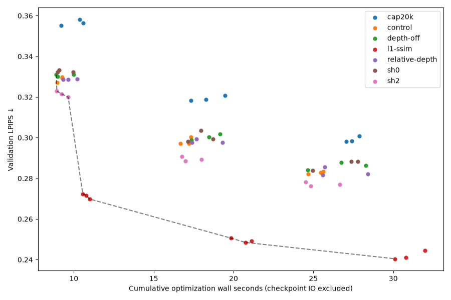

# Reconstruction-quality study: reconstruction-quality-1

The complete predeclared study ran on 2026-10-30: **24 training runs, 79,200
updates, 67 validation evaluations and 1,072 paired views**. All 91 training/
evaluation stages completed; zero failed stages were recorded. The stage span was
32.67 minutes. This is one previously exposed TUM sequence, three seeds and
validation-only selection. There is no independent-test or generalization result.

Training and report source is commit `15d783b` (full commit and 143 source-file
hashes in [provenance.json](evidence/reconstruction-quality-1/provenance.json)).
Each actual configuration hash, frozen dataset/split hash and original specification
hash is recorded there. The specification was committed before implementation and
training at `e1c56e3`. Neither historical results nor frozen splits were modified.

## Baseline and controls

The historical 1,200-step model was rendered/evaluated anew on all 16 validation
views: PSNR 15.18996 dB, SSIM 0.52168, LPIPS 0.32445. Three fresh standalone
1,200-step baselines establish the current implementation below. Historical
training timing is excluded from new runtime comparisons.

Seed42 fresh-minus-historical differences were −0.09715 dB and +0.00364 LPIPS,
within the predeclared 0.5 dB/0.03 discrepancy tolerances. The primary automatic
report flags the seed42 trajectory-versus-standalone check. Supplemental replay
checks all three seeds with those same tolerances; all pass. This is tolerance
agreement, not bitwise CUDA reproducibility. Both original checks and the
supplement are retained in the evidence directory.

## Measurements and selection

Values are means ± sample SD over three seeds. Depth support is the fraction of
valid reference-depth pixels also supported by positive predicted depth and
alpha≥0.1. Depth errors use that support, so different models can be scored on
different pixels; interpret MAE together with support. This ratio does not measure
whole-image coverage or count invalid reference-depth regions such as windows.

| Configuration | Updates | LPIPS ↓ | PSNR dB ↑ | Depth MAE m ↓ | Depth support ↑ | Optimization s | Mean Gaussians |
|---|---:|---:|---:|---:|---:|---:|---:|
| baseline | 1200 | 0.32864 ± 0.00107 | 15.072 ± 0.018 | 0.08293 ± 0.00031 | 0.98019 ± 0.00211 | 9.25 ± 0.13 | 17,964 |
| control | 1200 | 0.32876 ± 0.00139 | 15.078 ± 0.014 | 0.08273 ± 0.00048 | 0.98037 ± 0.00261 | 9.16 ± 0.19 | 17,945 |
| control | 2400 | 0.29820 ± 0.00181 | 15.334 ± 0.053 | 0.08214 ± 0.00148 | 0.98490 ± 0.00138 | 17.07 ± 0.34 | 17,945 |
| control | 3600 | 0.28287 ± 0.00061 | 15.353 ± 0.070 | 0.08206 ± 0.00130 | 0.98627 ± 0.00153 | 25.25 ± 0.52 | 17,945 |
| cap20k | 3600 | 0.29910 ± 0.00156 | 15.488 ± 0.112 | 0.08035 ± 0.00046 | 0.98505 ± 0.00122 | 27.45 ± 0.42 | 11,369 |
| sh0 | 3600 | 0.28683 ± 0.00250 | 15.366 ± 0.013 | 0.08136 ± 0.00115 | 0.98538 ± 0.00095 | 26.71 ± 1.52 | 17,869 |
| sh2 | 3600 | 0.27713 ± 0.00096 | 15.353 ± 0.072 | 0.08075 ± 0.00072 | 0.98442 ± 0.00035 | 25.34 ± 1.16 | 17,863 |
| depth-off | 3600 | 0.28600 ± 0.00188 | 15.337 ± 0.056 | 0.09747 ± 0.00359 | 0.99219 ± 0.00038 | 26.56 ± 1.83 | 17,690 |
| relative-depth | 3600 | 0.28312 ± 0.00204 | 15.359 ± 0.014 | 0.08565 ± 0.00122 | 0.98646 ± 0.00104 | 26.57 ± 1.60 | 17,769 |
| l1-ssim | 3600 | 0.24201 ± 0.00219 | 15.444 ± 0.051 | 0.08338 ± 0.00058 | 0.99042 ± 0.00033 | 30.96 ± 0.95 | 23,017 |

All three seeds selected **L1+SSIM at 3,600 updates**, using the frozen rule:
minimum mean validation LPIPS, ties within 1e-6 resolved by PSNR, fewer steps, then
arm ID. The complete 67-row [quality/runtime CSV](evidence/reconstruction-quality-1/quality-runtime.csv)
and [aggregates](evidence/reconstruction-quality-1/aggregates.json) retain every
budget and variant, rather than reporting only selected checkpoints.

At matched 3,600 updates, L1+SSIM has mean LPIPS 0.24201 versus control 0.28287,
with optimization time 30.96 versus 25.25 seconds and about 23,017 versus 17,945
Gaussians. Its masked depth MAE is slightly higher (0.08338 versus 0.08206 m),
with greater depth support. This compares whole training policies: changing the
objective also changes densification/count. It does not isolate loss effects at
fixed Gaussian count or establish a universal causal/runtime advantage.

## Negative and mixed results

- Cap20k worsened matched-budget LPIPS by 0.01623 at 3,600 steps, while PSNR improved.
  The conservative growth guard left about 11.4k Gaussians, below the nominal 20k
  cap. Fewer Gaussians did not produce lower observed optimization time in this run.
- Depth-off worsened LPIPS by 0.00313 and increased masked depth MAE to 0.09747 m
  versus 0.08206 m, with a larger scored support. RGB-D initialization remained.
- Relative-depth produced mixed seed effects and almost no mean LPIPS change
  (+0.00025); its masked depth MAE was higher. Equal numeric depth weights here
  have different units/effective gradient scales.
- SH0 worsened mean LPIPS by 0.00395. SH2 improved it by 0.00574, with similar observed
  optimization time; three ordered runs do not establish a latency advantage.
- Longer control training improved LPIPS through 3,600 steps, but PSNR mostly
  plateaued after 2,400. Some metrics regress: seed42 L1+SSIM validation SSIM falls
  from 0.5678 at 1,200 to 0.5610 at 3,600 despite lower LPIPS. No convergence claim is
  made beyond the tested budgets.

## Runtime and visual failures



Checkpoint IO was timed separately (4.64 seconds summed across trajectories).
Total optimization across the 24 runs was 594.26 seconds; stage span 32.67 minutes
also includes initialization, process startup, rendering and evaluation. The CSV
retains evaluation-stage and full-worker/adapter costs. Full-trajectory cost fields
repeat for its three checkpoints and must not be summed as independent runs.
Runtime order was fixed and unrandomized; these are local observations, not a
controlled hardware benchmark or portable speedup claim. The plotted Pareto
frontier is descriptive across the measured seed/budget points.

Training peaked at 100,306,944 allocated and 121,634,816 reserved PyTorch bytes,
under the enforced 4.5 GB training allocator cap on the GTX 1660 Ti 6 GB. These counters
exclude driver/context/display allocations. No OOM/nonfinite/budget failure was
recorded, and no failed arm was silently dropped or downgraded.

The local full HTML report is
`experiments/reconstruction-quality-1/analysis/report.html`. It includes actual
reference/control/selected RGB, residual, depth-error and support-mask montages.
The worst selected-model validation frame is `frame_00058` for all three seeds;
large window/background holes and blurred boundaries remain visible. Absolute
PSNR remains about 15 dB, so the LPIPS gains do not establish high visual fidelity.
RGB residual uses a fixed 0–1 scale; depth error uses 0–1 m, with invalid support black.

The fixed “largest-paired-degradation” rule chooses the maximum **signed** LPIPS
change against that seed's control-1200. Every selected delta is negative here:
these are the least-improved views, not actual degradations. Their original rule
names and signed values remain unchanged in
[failure-selection.json](evidence/reconstruction-quality-1/failure-selection.json).
The montages, raw RGB-D, learned parameters and full evaluation outputs remain
Git-ignored and can be regenerated from the protocol.

## Verification and limitations

[Acceptance replay](evidence/reconstruction-quality-1/acceptance.json) recomputes
all 1,072 RGB/depth/detector calculations against frozen validation observations,
checks original GT versus saved reference pixels, re-aggregates saved LPIPS values,
reproduces selection, verifies 132 allowed observation files and 5,458 historical
files, and records all 91 stage hashes. This replay does not repeat LPIPS network
inference. A cached-stage rerun separately validated every original model/render/
evaluation binding without retraining or altering completed outputs.

The [fresh experiment-integrity review](evidence/reconstruction-quality-1/EXPERIMENT_AUDIT.md)
and [narrative addendum](evidence/reconstruction-quality-1/EXPERIMENT_AUDIT_NARRATIVE.md)
returned **WARN, same-family provisional**. Numeric replay passed; interpretive
limits remain. The requested clarification of historical test-log attribution is
included below. Validation has prior project exposure and selection searches 21
candidates per seed. Temporally correlated views, a single capture, small seed
count, prediction-dependent depth support and variable Gaussian count constrain
all conclusions. No significance, detection accuracy, real-world geometry accuracy
or independent-test quality claim is made.

Executor-reported pre-training checks, retained in the parent Codex transcript:
189 CPU tests passed (four GPU tests skipped in that CPU run), four actual CUDA
tests passed, eight focused study tests passed, and lint, formatting, frontend 5
tests/build and CLI smoke passed. Original test stdout was not saved as raw files;
the fresh integrity audit does not independently certify these historical test
counts or their chronology. Fresh post-run verification logs are separately
labeled in the evidence directory.

The captured [post-run verification](evidence/reconstruction-quality-1/postrun-verification.json)
passed: **189 CPU tests, four GPU tests**, lint/formatting, frontend tests/build
and CLI smoke. Closure verification finished on 2026-10-31; the CPU
run skipped the four GPU tests before they were run separately. Hosted implementation CI
passed all four jobs: CPU, official sample, geometry and frontend/browser
[run 41049601408](https://github.com/phongviet/SimReady/actions/runs/41049601408).

Reproduction commands and acceptance rules are in
[RECONSTRUCTION_QUALITY_PROTOCOL.md](RECONSTRUCTION_QUALITY_PROTOCOL.md).
To perform an additional read-only numeric replay, use a new output filename:

```bash
UV_CACHE_DIR=$PWD/.cache/uv uv run --frozen python \
  docs/evidence/reconstruction-quality-1/replay.py \
  --out experiments/reconstruction-quality-1/verification/replay-NEW.json
```
