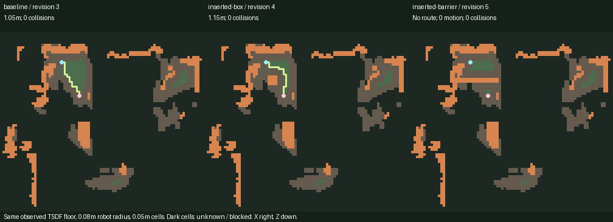

# Local occupancy navigation (M4 vertical slice)

The implementation is a deterministic CPU simulator over a metric XZ grid in the
same canonical Y-up frame as the reconstruction and proxies. It is not an
independent physics engine or real robot validation. M4 review/approval/export
and readiness diagnostics are now documented in REVIEW_PROTOCOL.md.

## Map and floor evidence

A saved scenario defines bounds, floor height/evidence, robot radius/height,
resolution, start/goal, optional ordered waypoints, speed, timestep and seed.
The grid is bounded to 256×256 cells and replay to 100,000 samples; unsupported
large configurations fail explicitly. Unknown cells and the exterior are blocked.

- `observed_tsdf`: near-horizontal mesh triangles (absolute Y normal / length
  >=.85) whose vertices lie within the configured floor tolerance provide floor
  support. This is coarse surface evidence with inherited calibration/gravity
  uncertainty, not verified free volume. No hole filling certifies unknown space.
- `declared_virtual_plane`: support inside the map rectangle is an explicit
  simulator assumption. A required note records this. The analytic reconstruction
  is a vertical wall; the demo's floor is **not observed** in that reconstruction.

Triangles intersecting the vertical slab from floor+ground-clearance to
floor+robot-height are clipped and conservatively projected to occupied XZ cells.
Convex polygon/cell SAT includes boundary contact. Collidable proxy boxes use the
same world transform as the editor; their slab intersection is a **solid** convex
footprint, including interiors. Hidden but collidable proxies remain obstacles.
Coarse TSDF surfaces do not establish watertight solid occupancy truth.

Raw blocked cells are mesh/proxy occupancy or missing floor support. Exterior is
padded as blocked. Euclidean-distance inflation uses robot radius plus
`sqrt(2)*resolution` to account conservatively for cell/within-cell position
uncertainty. The resulting mask represents permitted robot-center cells.

## Planner, controller and metrics

Four-neighbor A* uses Manhattan distance, deterministic tie ordering, and no
random sampling. The saved seed is provenance; this algorithm has no RNG.
Planning visits start, waypoints and goal in order. Blocked/unknown endpoints or
unreachable goals return an explicit failed result with no trajectory and null
planned path length. No motion implies zero collisions, **not route success**.

Successful plans include exact start/goal and grid-center segments. Replay uses
speed and clock samples, inserting exact corner events so it follows the planned
polyline without cutting corners. Each move is independently swept with spacing
<=resolution/4; collision terminates motion. Saved metrics are planned path length,
actual traveled distance, collision count, route success/reason, elapsed simulated
time and separately measured wall-clock compute time. A stationary start=goal
has zero distance/time. All units are meters/seconds.

Planning and replay use the same declared coarse map, so these metrics validate
internal route feasibility/controller behavior only. They do not measure real
navigation, sensor realism, sim-to-real transfer or broad safety.

## Saved runs and interface

Scenario edits create immutable scene revisions with optimistic version checks.
Runs bind to a captured scene revision even if later edits occur. Each directory
has scenario, full scene input, occupancy JSON/NPZ, result/trajectory JSON, route
PNG, and a manifest with content hashes, geometry hash, source commit/dirty state,
source-file digests, dependency versions, floor assumptions and limits. Assets
are served only from the registered run allowlist and checked against hashes.

```bash
uv run --frozen simready sim save --scene analytic-demo --config configs/scenario_analytic.json
uv run --frozen simready sim run --scene analytic-demo --scenario analytic-route
uv run --frozen simready sim list --scene analytic-demo
```

`--scene` is a **registered scene ID**, with optional `--root` registry path.
The Navigation tab supports numeric scenario editing, versioned saving, running,
persistent result selection, 2D evidence and an animated 3D robot/route overlay.
The viewer uses saved **run-input objects**, not later scene edits. The overlay
is explicitly simulated; it does not participate in offline perception metrics.

The TUM floor example selects endpoints from the largest connected supported
component of the observed map. It demonstrates known-map planning and is not an
independently selected robotics task benchmark. The small observed patch and
unknown cells are part of the result, not hidden by declaring all space free.

## Actual real-geometry layout regression

Clean source **1afbb60**, output registry `artifacts/m4-navigation-1`. Reproduce
with a new output path:

```bash
uv run --frozen python scripts/run_navigation_layouts.py --root artifacts/my-navigation-run
```

The script preserves the original TUM studio scene and registers a separate
navigation scene. The same frozen TSDF, observed-floor scenario, 0.08m virtual
robot radius, 0.05m grid, endpoints and controller are used in all three layouts.
Explicit proxy placements are pinned in `configs/navigation_layouts.json`.

| Layout | Source revision | Route | Path/travel | Simulated time | Replay collisions |
|---|---:|---|---:|---:|---:|
| Baseline | 3 | Goal reached | 1.05m | 7.000s | 0 |
| Inserted 0.15m box | 4 | Goal reached via detour | 1.15m | 7.667s | 0 |
| Inserted 0.8m barrier | 5 | No supported route | No planned path; 0m travel | 0s | 0 |

All layouts retain **947 floor-support cells and 5,269 unknown cells**. Permitted
robot-center cells decrease from125 to83 to68. In the blocked case zero collisions
means the robot never moved, not that it reached the goal. These are measured
results of our simplified map/planner and manually declared task, not real robot
performance or independently verified physical free space. Source geometry:
TUM RGB-D fr1 desk, Sturm et al., IROS2012, CC BY4.0; map visuals are derivatives.



[Actual acceptance outputs](evidence/m4-navigation-acceptance.json) and the three
`m4-*-simulation.json` manifests include source/geometry/config/content digests.
Every registered asset hash was verified. The complete maps and trajectories
remain in the local registry; no value in this table is a placeholder.
